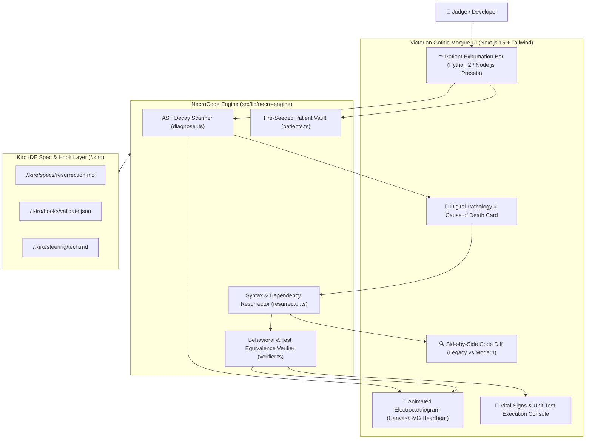

# 🏗️ Technical Architecture & Design: NecroCode

> **System Component Architecture & State Machine**

---

## 1. System Architecture Diagram



---

## 2. Patient Data Contract (TypeScript Interfaces)

```typescript
export type LanguageType = "python" | "javascript" | "typescript";
export type VitalStatus = "DEAD" | "RESURRECTING" | "ALIVE";

export interface NecroPatient {
  id: string;
  name: string;
  deceasedYear: number;
  language: LanguageType;
  cemeteryLocation: string;
  causeOfDeath: string[];
  deadCode: string;
  expectedModernCode: string;
  testCases: Array<{
    name: string;
    legacyStatus: "FAIL" | "SYNTAX_ERROR";
    resurrectedStatus: "PASS";
  }>;
}

export interface AutopsyReport {
  patientId: string;
  toxicityScore: number; // 0 to 100%
  fatalErrors: Array<{
    line: number;
    rule: string;
    description: string;
    legacySnippet: string;
    repairedSnippet: string;
  }>;
  summary: string;
  resurrectedCode: string;
  testPassRate: number; // 100%
}
```

---

## 3. UI Layout & Visual Language
* **Atmosphere:** Dark Gothic laboratory.
* **Palette:**
  * Background: `#0B0C10` (Dark Obsidian)
  * Secondary Card: `#141821` (Morgue Slate)
  * Toxic Accent: `#00FFA3` (Reanimation Green)
  * Fatal Error Accent: `#FF4C4C` (Flatline Red)
  * Text: `#E2E8F0` (Bone White)
