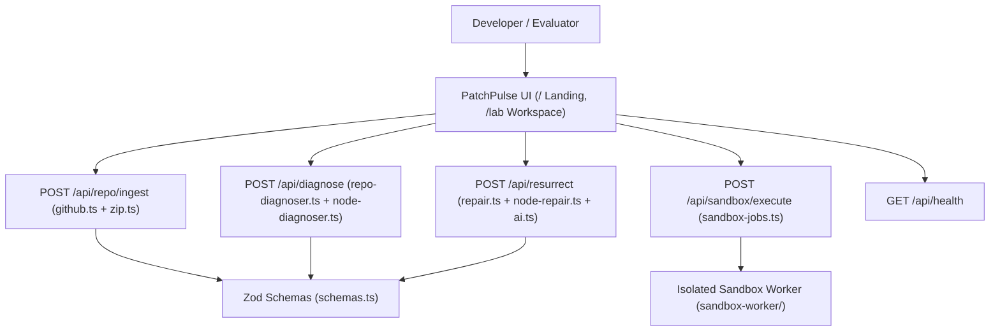

# 🏗️ Technical Architecture & Design: PatchPulse

---

## 1. System Architecture

---

## 2. Core Modules & API Contracts
* `src/lib/necro-engine/schemas.ts` — Zod schemas for ingestion, diagnosis findings, TypeScript compiler diagnostics, file patches, and sandbox results.
* `src/lib/necro-engine/github.ts` & `zip.ts` — Public GitHub REST ingestion and zero-dependency ZIP parser blocking symlinks and traversal.
* `src/lib/necro-engine/language-detector.ts` — Multi-language and framework detection for Python, JavaScript, and TypeScript.
* `src/lib/necro-engine/repo-diagnoser.ts` & `node-diagnoser.ts` — Multi-file compatibility, dependency conflict, `ast.parse` / `node --check` / `tsc --noEmit`, and test-discovery analyzers.
* `src/lib/necro-engine/repair.ts`, `node-repair.ts` & `src/lib/ai.ts` — Deterministic AST/codemod transforms + `@google/generative-ai` JSON patch generation with syntax validation.
* `src/lib/necro-engine/sandbox-jobs.ts` & `sandbox-worker/` — Isolated offline Python 3.12 & Node 20 execution workers (`docker` or macOS `seatbelt`).

---

## 3. Kiro Artifacts
* `.kiro/specs/requirements.md`, `.kiro/specs/design.md`, `.kiro/specs/tasks.md`
* `.kiro/steering/product.md`, `.kiro/steering/tech.md`
* `.kiro/hooks/validate.json`
