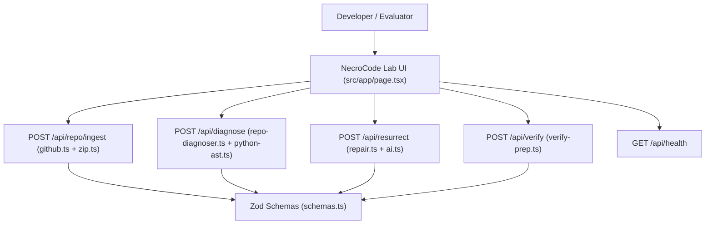

# 🏗️ Technical Architecture & Design: NecroCode

---

## 1. System Architecture

---

## 2. Core Modules & API Contracts
* `src/lib/necro-engine/schemas.ts` — Zod schemas for ingestion, diagnosis findings, file patches, Gemini output, and verification requests.
* `src/lib/necro-engine/github.ts` & `zip.ts` — Public GitHub REST tree/blob ingestion and zero-dependency ZIP parser blocking symlinks and traversal.
* `src/lib/necro-engine/python-ast.ts` — Safe non-executing `ast.parse` inspector (`spawnSync` with stdin, `shell: false`).
* `src/lib/necro-engine/repo-diagnoser.ts` — Multi-file Python compatibility, dependency conflict, config, and test-discovery analyzer.
* `src/lib/necro-engine/repair.ts` & `src/lib/ai.ts` — Deterministic AST/codemod transforms + `@google/generative-ai` JSON patch synthesis with mandatory post-patch syntax validation.
* `src/lib/necro-engine/verify-prep.ts` — Syntax validation, test discovery, sandbox policy plan, and structured logging (`SYNTAX_PASSED_SANDBOX_PENDING` / `FAILED`).

---

## 3. Kiro Artifacts
* `.kiro/specs/requirements.md`, `.kiro/specs/design.md`, `.kiro/specs/tasks.md`
* `.kiro/steering/product.md`, `.kiro/steering/tech.md`
* `.kiro/hooks/validate.json`
