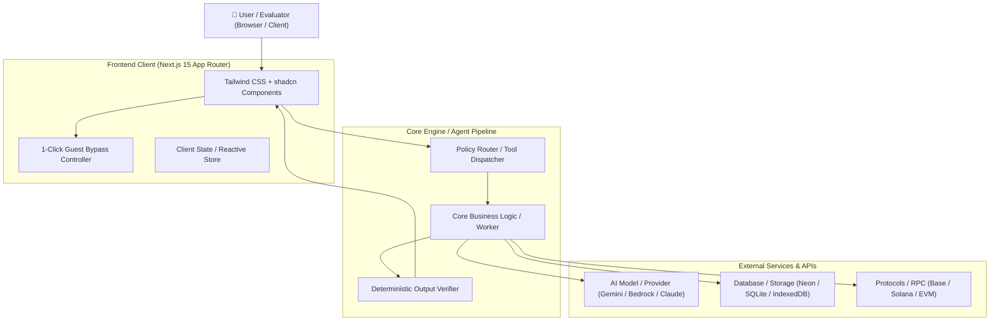

# 🏗️ Technical Architecture & Design: NecroCode

> **Source Standard:** Spec Kit Architecture & OpenPencil Design Specification

---

## 1. System Architecture Diagram



---

## 2. Component Hierarchy & Layout Plan
* **Shell:** Responsive Navbar (Logo, Status Badge, ThemeToggle, Demo Bypass Button).
* **Main Stage:**
  * Left / Top: Input Console (File upload, text prompt, or 1-click Preset Selector).
  * Right / Bottom: Live Execution Canvas (Interactive results, animated status, output diff).
* **Inspector:** Expandable Telemetry / Network Disclosure drawer (showing honest latency, model name, and zero-leak payload proof).

---

## 3. Data Schema & Contracts (Zod / TypeScript)
Define all inputs and outputs with strict runtime schemas to eliminate hallucinations:

```typescript
// Example: Strict output constraint
export interface VerificationResult {
  id: string;
  timestamp: string;
  status: "PASSED" | "FLAGGED" | "FAILED";
  metrics: {
    confidenceScore: number;
    latencyMs: number;
  };
  findings: Array<{
    code: string;
    description: string;
    severity: "low" | "medium" | "critical";
  }>;
}
```

---

## 4. Error Handling & Fallback Strategy
* **Offline / Timeout:** Show simulated pre-seeded fallback data with a transparent `DEMO_MODE` badge instead of breaking.
* **Input Validation:** Reject oversized inputs with clear, polite client-side warnings before triggering API calls.
