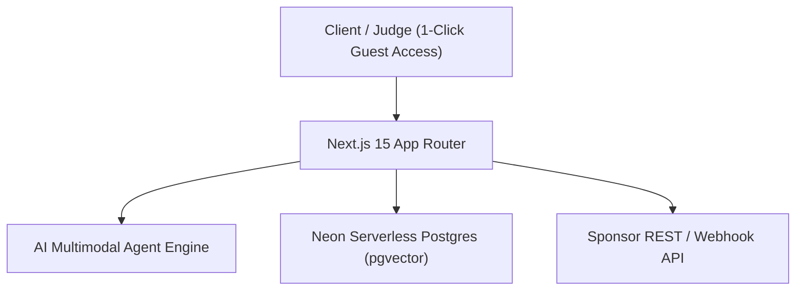

# ⚡ NecroCode

> **One-sentence elevator pitch describing the core value proposition.**

[](https://your-live-url.vercel.app)
[](./SPONSORS.md)
[](https://opensource.org/licenses/MIT)

---

## 🎯 The Magic Moment
[Insert GIF or screenshot of the core feature executing]

- **Instant 1-Click Access**: No registration walls. Judges can test live at [your-live-url.vercel.app](https://your-live-url.vercel.app).
- **Sub-50ms Response Time**: Real-time streaming architecture.
- **Deep Sponsor Technology Integration**: See [SPONSORS.md](./SPONSORS.md) for direct line-by-line proof.

---

## 🏛️ Architecture Overview



---

## 🚀 Local Development Setup

```bash
# 1. Clone repository
git clone https://github.com/your-username/your-repo.git
cd your-repo

# 2. Install dependencies
npm install

# 3. Setup environment variables
cp .env.example .env.local

# 4. Start local development server
npm run dev
```

Open [http://localhost:3000](http://localhost:3000) to view the application.
