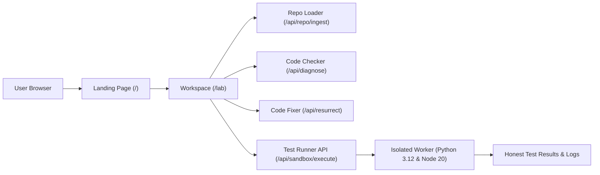

<p align="center">
  
</p>

<h1 align="center">PatchPulse</h1>

<p align="center">
  <strong>Fix outdated Python, JavaScript, and TypeScript code—and prove every fix works inside an offline test sandbox.</strong>
</p>

<p align="center">
  <a href="https://github.com/GhulamMustufa/patchpulse">
    
  </a>
  
  
  
</p>

---

## What PatchPulse Does

Old repositories rarely break because the logic was bad—they break because languages and packages move forward.

**PatchPulse** takes legacy Python, JavaScript, or TypeScript projects, finds real syntax and dependency errors, prepares clean code updates you can inspect side-by-side, and verifies those fixes inside an offline sandbox.

- **No signup required:** Open the workspace and test a built-in example or your own code immediately.
- **No blind AI guesses:** Checks real compiler/syntax rules first, uses Gemini AI when configured, and falls back to built-in offline repair rules without needing an API key.
- **No fake test passes:** If no tests exist or a dependency cannot run offline, PatchPulse clearly tells you instead of reporting a fake pass.

---

## How It Works (3 Simple Steps)

1. **Add Your Code** (`/lab`)
   - Pick a built-in sample project, paste your own code snippet, enter a public GitHub URL, or upload a `.zip` archive (up to 15 MB / 40 files).
2. **Review the Fix**
   - Click **Fix Code** to scan for outdated syntax, TypeScript errors, and unsafe packages.
   - Review every change in Split View or Diff View, then click **Approve Fix**.
3. **Run Safe Offline Tests**
   - Click **Run Tests** to execute tests inside an isolated worker (`docker` container or macOS `seatbelt` sandbox) with network disabled and zero access to host secrets.

---

## App Pages

| Route | Purpose |
|---|---|
| `/` | Clean landing page with an interactive Python / JS / TS before-and-after preview |
| `/lab` | Full interactive workspace (Samples, GitHub/ZIP, Paste Code, Editor/Diff, Issues, Test Results, Logs) |
| `/dashboard` | Live system health check (`/api/health`) and quick shortcuts to sample projects |
| `/docs` | Quick guide, pipeline overview, API reference, and sandbox safety rules |

---

## Supported Languages & Test Runners

| Language | Target Runtime | What PatchPulse Checks & Repairs | Supported Test Runners |
|---|---|---|---|
| **Python** | Python `3.12` | Python 2 `print` statements, removed modules (`urllib2`, `ConfigParser`), `.iteritems()`, `xrange()`, unsafe package lines | `pytest`, `unittest`, top-level `def test_*` |
| **JavaScript** | Node.js `20 LTS` | `new Buffer()` security risks, removed/outdated packages (like `request`), `fs.exists`, `url.parse`, CJS/ESM syntax | `node --test` (`node:test`) |
| **TypeScript** | TypeScript `5.9` | Real `tsc --noEmit` diagnostics, strict type fixes, implicit `any`, target compilation checks | `tsc --noEmit` + `node --test` |

---

## Architecture Overview



---

## Quick Start (Local Development)

### Prerequisites
- Node.js `20.x` or newer (`npm`)
- Python `3.12` (or `python3`)
- Optional: Docker Desktop (or macOS built-in `sandbox-exec`, used automatically for local testing)

### 1. Clone & Install

```bash
git clone https://github.com/GhulamMustufa/patchpulse.git
cd patchpulse
npm install
```

### 2. Environment Setup (Optional)

Copy the example config if you want to connect Gemini AI or Neon Postgres. Everything still works offline without any keys.

```bash
cp .env.example .env
```

### 3. Run the App

```bash
npm run dev
```

Open **[http://localhost:3000](http://localhost:3000)** in your browser, then click **Open Live Workspace** (or go straight to `http://localhost:3000/lab`).

### 4. Run Tests & Security Checks

```bash
# TypeScript type check
npx tsc --noEmit

# Lint check
npm run lint

# Full unit, ingestion, and sandbox isolation test suite (8 suites, 40 tests)
npx vitest run --no-file-parallelism

# Secret & dangerous-code security scan
npm run test:security

# Production build
npm run build
```

---

## Further Reading

- **[Documentation Hub](./docs/README.md)** — Plain-English guide to every QA, security, and implementation document
- **[Devpost Pitch & Overview](./SUBMISSION.md)** — Project summary, design choices, and demo walkthrough
- **[Sandbox Architecture](./docs/security/SANDBOX_ARCHITECTURE.md)** — How untrusted code is kept isolated
- **[Verification Engine](./docs/qa/VERIFICATION_ENGINE.md)** — Exact status rules so passes are never faked
