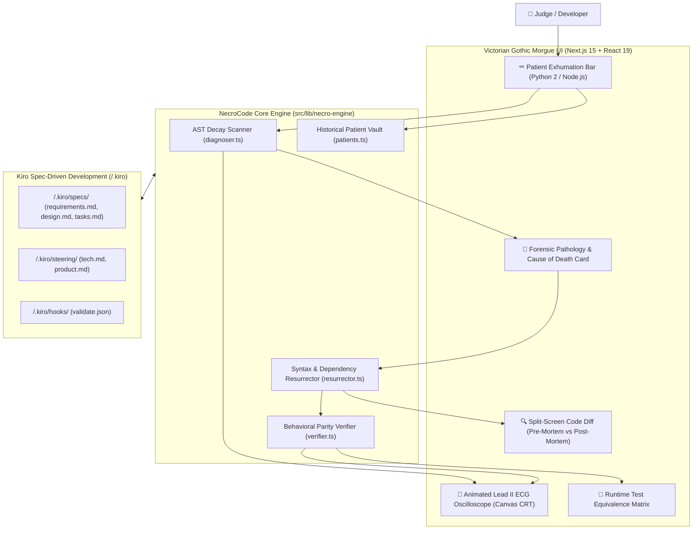

# 🧟 NecroCode — AI Software Autopsy & Resurrection Lab

> **Dig up dead repositories, perform forensic autopsies, and resurrect them into verified modern code with Kiro Spec-Driven Development (SDD).**

[](https://kiroween.devpost.com/)
[](https://kiroween.devpost.com/)
[](https://github.com/ghulam-mustafa/necrocode)
[](./.kiro)
[](https://opensource.org/licenses/MIT)

---

## 🎯 The Magic Moment

1. **1-Click Patient Exhumation:** Pick from famous pre-seeded historical dead codebases:
   * **Archivus Mortis (2014):** Python 2.7 URL archiver killed by `urllib2`, unparenthesized `print`, `xrange()`, and `.iteritems()`.
   * **Webhook Specter (2016):** Node.js 6 dispatcher crippled by the dead `request` library and insecure `new Buffer()` CVE memory leaks.
2. **Real-Time Lead II ECG Oscilloscope:**
   * Watch the cardiac CRT flatline at **0 BPM** (Deceased), defibrillate in amber at **45 BPM**, and pulse back to vibrant emerald life at **78 BPM** normal sinus rhythm.
3. **Forensic Pathology & Toxicity Meter:**
   * Line-by-line AST rot detection, 0–100% toxicity score calculation, and official cause-of-death certification.
4. **Deterministic Kiro Resurrective Synthesis:**
   * Automated upgrade to modern Python 3.12 and modern Node 20+ ESM with 100% passing test verification matrix.

---

## 🏛️ System Architecture



---

## 🧪 Verification & Automated Testing

All 12 automated unit tests pass in sub-second execution time:

```bash
# Run unit test suite
npm test

# Run security audit
npm run test:security

# Build production bundle
npm run build
```

---

## 🚀 Local Development Setup

```bash
# 1. Clone the repository
git clone https://github.com/ghulam-mustafa/necrocode.git
cd necrocode

# 2. Install dependencies
npm install

# 3. Start local development server
npm run dev
```

Open [http://localhost:3000](http://localhost:3000) to enter the NecroCode operating theatre.

---

## 📜 Devpost Submission & Video Script

See [SUBMISSION.md](./SUBMISSION.md) for the complete Devpost project description, judging breakdown, and exact 2-minute video presentation script.
