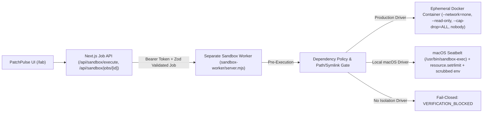

# PatchPulse — Sandbox Execution Architecture

> **In plain English:** Submitted code never runs inside the Next.js web server. It runs inside an offline, locked-down worker with strict time, memory, and disk limits—and if isolation isn't available, tests are blocked instead of faking a pass.

**Environment Verified:** macOS Darwin (arm64), Python 3.12 (`/opt/homebrew/bin/python3.12`), `/usr/bin/sandbox-exec` (Seatbelt), and optional Docker (`docker image inspect` verified before selecting Docker).

---

## 1. Core Security Principle

**Untrusted repository code MUST NEVER execute inside the Next.js application server process or with access to application secrets (`GEMINI_API_KEY`, `DATABASE_URL`, `GITHUB_TOKEN`, `SANDBOX_WORKER_TOKEN`).**

Instead, Next.js acts strictly as an authenticated job orchestrator and UI gateway that communicates with an isolated **Sandbox Worker (`sandbox-worker/`)**.

---

## 2. System Topology

---

## 3. Execution Drivers & Honest Isolation Guarantees

| Driver | When Used | Isolation Mechanisms Enforced | Honest Limitations |
|---|---|---|---|
| **1. `docker` (Recommended Production)** | Docker daemon reachable (`docker info` succeeds) and `SANDBOX_DRIVER=docker` or `auto` | Linux namespaces (PID, net, mount, IPC), `--network=none`, `--read-only`, `--cap-drop=ALL`, `--security-opt=no-new-privileges:true`, `--user=65534:65534`, `--memory=128m --memory-swap=128m`, `--cpus=0.5`, `--pids-limit=32`, `--ulimit nofile=64:64 --ulimit fsize=1048576:1048576`, `--tmpfs /tmp:rw,noexec,nosuid,nodev,size=32m`, zero host env vars, `docker rm -f` cleanup | Requires Docker daemon & `python:3.12-slim` (or built `necrocode-sandbox:py312` image) on worker host; NOT available on standard serverless hosts (e.g., Vercel) without a separate container/VM host. |
| **2. `seatbelt` (macOS Local Dev/Test)** | Darwin host with `/usr/bin/sandbox-exec` when Docker daemon is unavailable | Kernel MAC profile denying `network*`, denying `file-write*` outside ephemeral job temp dir, denying `file-read*` on `/Users` (outside job dir), `/etc/master.passwd`, `/private/var/root`, etc.; scrubbed environment (`PATH` + `PYTHONNOUSERSITE=1` only); Python `resource.setrlimit` (`RLIMIT_CPU`, `RLIMIT_NPROC`, `RLIMIT_FSIZE`, `RLIMIT_NOFILE`); hard wall-clock `SIGKILL` timeout; temp dir deleted in `finally` | macOS Seatbelt is a local dev/CI process sandbox, not a full VM or Linux cgroup container. `RLIMIT_AS` is advisory on macOS ARM64; host kernel is shared. Not recommended as sole isolation for public multi-tenant internet exposure. |
| **3. `unavailable` (Fail-Closed)** | Neither Docker daemon nor Seatbelt is available (or `SANDBOX_WORKER_URL` unset in strict mode) | Refuses execution immediately (`VERIFICATION_BLOCKED`) | Never falls back to unsandboxed `python3` on the host. |

---

## 4. Controlled Python 3.12 Verification Pipeline

Inside the isolated worker (`sandbox-worker/runner.py`):
1. **Stage A — Syntax Compilation (`py_compile`):** Compiles every `.py` file inside the ephemeral workspace without importing or executing top-level code. Captures exact `SyntaxError` file, line, and message.
2. **Stage B — Test Discovery:** Parses AST / patterns to identify `unittest.TestCase` classes, `pytest` suites, and `def test_*` functions.
3. **Stage C — Fixed-Command Execution:**
   - Never runs arbitrary commands from `setup.py`, `Makefile`, `tox.ini`, or `pyproject.toml`.
   - Never concatenates shell strings (`shell: false` / `execFile` / `spawn` argument arrays only).
   - Runs `unittest` via fixed Python runner (or `pytest -q` when available inside the Docker image) and executes discovered `def test_*` functions via fixed harness if `pytest` is absent.
   - If zero tests are discovered, returns `NO_TESTS_FOUND` (`SYNTAX_VERIFIED`, never `RESURRECTED`).
4. **Stage D — Output & Resource Caps:**
   - Wall-clock timeout (default 10s, max 20s) kills process group (`SIGKILL`).
   - Stdout/stderr capped at 64 KB and sanitized (stripped ANSI/control sequences, host temp path masked as `/workspace`).

---

## 5. Controlled Dependency Handling

Untrusted `requirements.txt` / `pyproject.toml` files are **inspected before execution**:
1. Reject unsafe directives: `-e`, `--index-url`, `--extra-index-url`, `--find-links`, `--trusted-host`, VCS/URL packages (`git+`, `http://`, `https://`, `file://`), path traversal (`../`, `/`).
2. Classify stdlib-only projects (`STDLIB_ONLY_READY`) vs projects requiring third-party packages.
3. If third-party packages are required:
   - Check optional pre-verified offline wheelhouse (`SANDBOX_WHEELHOUSE_DIR`, mounted `:ro` with `--no-index`).
   - If not satisfied offline, fail safely with `DEPENDENCY_PREPARATION_FAILED` instead of granting internet access inside the sandbox.

---

## 6. Deployment Topology

* **Next.js App (`src/app/api/sandbox/*`)**: Deployed on web tier with `SANDBOX_WORKER_URL` and `SANDBOX_WORKER_TOKEN`. Never runs untrusted code locally.
* **Sandbox Worker (`sandbox-worker/`)**: Deployed on a dedicated Linux container host (VM / ECS / Fly / bare-metal Docker host) bound to private network or `127.0.0.1:4100`, authenticating requests with constant-time Bearer token verification.
